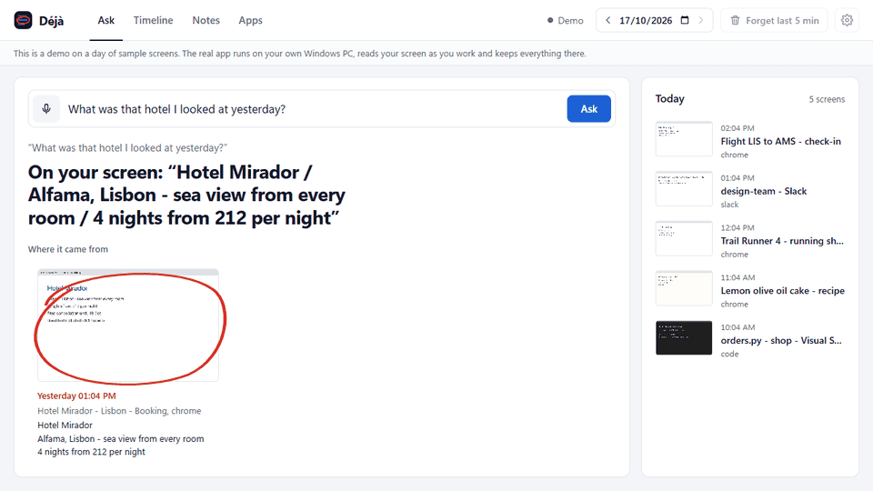

# Déjà

A memory of your own screen that you can talk to. Windows, fully local. [Try the demo](https://deja-hacktoberfest.vercel.app) (sample screens).



*The real app on a day of sample screens.*

Every few seconds Déjà reads what is on your screen, keeps the text in a search index on your disk next to a small
screenshot, and lets you ask about it later, by voice or by typing:

- "What was that hotel I looked at yesterday?"
- "What error did I get in orders.py this morning?"
- "Remind me to call the dentist tomorrow at 5"
- "Note that the spare key is with Sam"

Questions come back as one sentence plus the screenshots that matched, with the one the answer came from circled.
Reminders pop up as a Windows notification when they are due.

## Run it

On Windows 10/11, with nothing else installed: download `Deja-windows.zip` from the
[latest release](https://github.com/Phantom8420/Hacktoberfest/releases/tag/deja-v0.1.0), unzip it anywhere and run
`Deja\Deja.exe`. It opens the page and sits in the tray; tick *Start at sign-in* in the tray menu to keep it running.
The exe isn't code-signed, so Windows may show "Windows protected your PC" the first time: *More info*, then *Run
anyway*.

From source, with Python 3.11 or newer installed, right-click `install.ps1` and choose *Run with PowerShell*. It
sets everything up in `.venv` inside this folder, adds Déjà to sign-in, and starts it in the tray (click the eye to
open it; right-click to pause, forget the last 5 minutes, turn start-at-sign-in on or off, or quit). Reminders fire whenever you're signed in, whether
or not the page is open.

By hand:

Needs Windows 10/11 and Python 3.11 or newer. [Ollama](https://ollama.com) with `gemma3:1b` is optional: without it
you still get the matching screenshots, with the line that best matches your question quoted as the answer.

```bash
python -m venv .venv
.venv/Scripts/pip install -r requirements.txt
ollama pull gemma3:1b
.venv/Scripts/python -m deja
```

It opens `http://127.0.0.1:8777` in your browser and starts recording. The first spoken question downloads the Whisper
`base.en` model (about 140 MB) and the OCR models once.

| option | what it does |
|---|---|
| `--home DIR` | where memories are kept (default `%LOCALAPPDATA%\Deja`) |
| `--port N` | web page port (default 8777) |
| `--no-record` | open the app without recording |
| `--no-browser` | don't open the page |
| `--public` | serve the sample screens to other machines, read-only, no recording |
| `--install` / `--uninstall` | start Déjà in the tray at every sign-in, or stop doing that |

Answers come from `gemma3:1b` by default, which fits on any PC. With 16 GB of RAM or more, `ollama pull gemma3:4b`
and set `DEJA_GEMMA=gemma3:4b` in `.env` for noticeably better sentences.

Hotkeys, anywhere in Windows: **Ctrl Alt P** pauses or resumes, **Ctrl Alt F** forgets the last 5 minutes.

## Online demo

A web page can't see your screen, so the online demo is a static site in `site/` with a day of sample screens
(`deja/demo.py`). `build_site.py` runs the real search and Gemma on a set of questions once and saves the
answers; in the browser, `deja/web/static.js` stands in for the local server, replays those answers and searches
the sample screens itself for anything else. Notes and reminders are parsed but not kept, and there is no mic.

```bash
.venv/Scripts/python build_site.py   # needs Ollama with gemma3:1b running
cd site && npx vercel deploy --prod   # live at https://deja-hacktoberfest.vercel.app
```

Any static host works: it is plain files, no build step. On Vercel's dashboard, import the repo and set the
root directory to `Week2/site`.

## What it never records

- **Windows that ask not to be captured.** Password managers, banking apps and DRM video that set Windows' capture
  exclusion come out black, the same way they do in any screen recorder. Black frames are thrown away.
- **The lock screen, sign-in and admin (UAC) prompts.** They live on a separate secure desktop; Déjà checks for it
  and skips.
- **Private browser windows** (InPrivate, Incognito, Private Browsing) and any app on the excluded list (password
  managers are on it by default; edit it in Settings).
- **Anything while paused.**

Before a screen is saved, every line that looks like a secret is replaced in the text and painted black in the
screenshot: API keys and tokens, `password = ...` lines, card numbers that pass the Luhn check, one-time codes, and
long random-looking strings.

Everything kept on disk is encrypted with AES-256-GCM: screenshots, the text read from them, window titles, app
names and your notes. The key is created on first run and locked with Windows DPAPI, so only your Windows account on
this PC can open it; copy the folder anywhere else and it is noise, and a file changed on disk is refused rather than
read. The search index holds keyed hashes of three-letter pieces of text, not the text itself; someone with the files
but not the key can see how often the same piece repeats, never what it is. Only the times are stored readable. A
store from before encryption is encrypted on first start and the readable copy deleted.

Nothing leaves the computer. The web page listens on 127.0.0.1 only and refuses requests from other websites (it
checks the Host header and the browser's Sec-Fetch-Site, and only accepts JSON or audio bodies). Screens older than
30 days are deleted (change it in Settings). You can forget one screen, the last 5 minutes, or everything.

## How it works

| step | done by |
|---|---|
| capture the foreground window's monitor when it changes | `mss`, a 64×40 thumbnail diff |
| read the text | RapidOCR (PP-OCR, ONNX Runtime, CPU) |
| hide secrets | regular expressions in `deja/scrub.py` |
| store | AES-256-GCM with a DPAPI-locked key (`deja/vault.py`) |
| search | SQLite FTS5 over hashed three-letter pieces, so "error" finds "ConnectionError" |
| search by meaning | when your words match fewer than three screens, Gemma suggests words the screen may have used ("how expensive" → price, nights) and those are searched too |
| hear you | faster-whisper `base.en`, int8 on CPU |
| note or question, and when | code: `deja/voice.py` and `deja/when.py` ("tomorrow at 5", "last tuesday", "in 20 minutes") |
| answer | Gemma 3 1B through Ollama, given only the top five matching screens; without it, code quotes the best-matching line |

The model never searches. Code finds the screens, Gemma only reads the few that matched and says which one answers
you. If its answer contains a number that was not on any of those screens, the answer is dropped, and so is a refusal
when the answer is in plain sight: you get the best-matching line quoted from the screen instead.

Measured with `bench.py` on an i5-12500H laptop (16 threads, no GPU), recording the real 2880×1800 screen:

| | |
|---|---|
| reading one full screen | 5.3 s, on 2 threads at below-normal priority |
| CPU while the screen isn't changing | 0.7% of the machine |
| CPU while it changes constantly | at most 2 of 16 threads busy, about 13% (peak seen: 14%) |
| memory | 380 MB |
| disk | about 100 KB per screen kept, so a busy day of 2,000 screens is about 200 MB |

When OCR falls behind it skips to the newest screen rather than queueing. Whisper turns a short spoken question into
text in under a second. To measure your own PC, `python bench.py 300` records your real screen for five minutes into
a throwaway folder, prints the same numbers and deletes what it recorded.

How well it reads, from `python ocr_eval.py` (20 rendered screens with known text, so a best case: real screens have
more clutter):

| screens | characters right | words read exactly |
|---|---|---|
| 14 ordinary: Segoe UI, Consolas, Arial, Calibri, Tahoma, Verdana, Times at 12-20px, light and dark themes, code | 100.0% | 99.7% |
| 6 hard: 10-11px text, low contrast, text over a busy picture | 99.4% | 96.3% |

The weak spot is very small text over pictures (88% of words at 11px). Search still finds most of those words, since
it matches three-letter pieces rather than whole words.

## Limits

- Windows only (capture, secure-desktop check, hotkeys, notifications, DPAPI).
- Encryption protects the files from other accounts, other PCs and a stolen disk. It can't protect them from
  malware already running as you, which could also just watch your screen.
- Text, not pictures: it finds what was written on screen, not what an image showed.
- A 1B model sometimes gives a clumsy or partial sentence (see `gemma3:4b` above). The screenshots underneath are
  always the real evidence.
- The secret filter is pattern-based. It will miss a password typed somewhere that does not look like one, so keep
  password managers excluded and pause for anything sensitive.
- Times are read in English only.

## Tests

```bash
.venv/Scripts/python -m pytest -q
```

29 tests: secret scrubbing (both directions), nothing readable on disk, tamper detection, encrypting an old store,
search by meaning, tidying padded answers, time parsing, note/question routing, search and forgetting, the
number check on answers, quoting the best line when there is no model or it refuses, OCR painting a key black in a real screenshot, reporting OCR that can't start, the server
refusing other sites, the read-only hosted demo, and Whisper hearing a spoken reminder. The OCR and Whisper tests load
real models and need about 1.5 GB of free memory.

## Credits

RapidOCR and PaddleOCR (Apache-2.0), faster-whisper (MIT) and OpenAI Whisper (MIT), Gemma 3 (Gemma Terms of Use),
Ollama (MIT), python-mss (MIT).

AI assistance was used for this project: Claude (Anthropic) wrote most of the code and this README under my
direction.
