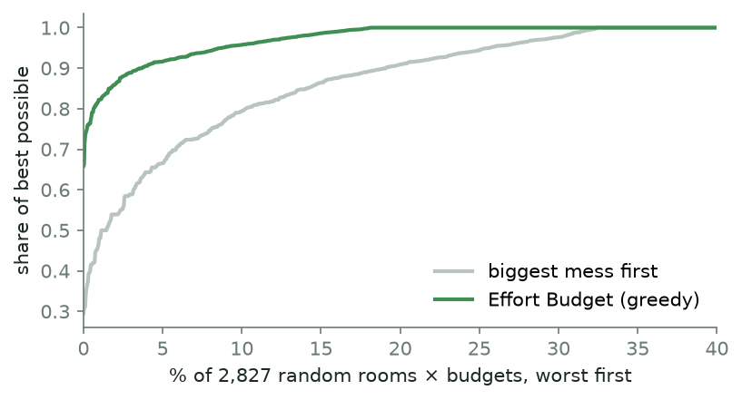

# Effort Budget

The most tidiness for the energy you have left. Fully local. [Try the demo](https://effort-budget.vercel.app) (sample rooms).

Show it a photo of your room and say how much energy you have, anywhere from 10 seconds to 10 minutes. Gemma 3
looks at the photo and lists what's lying around, where it should go, how long that takes and how much it would
help. A small planner then picks the moves worth the most tidiness for exactly that many seconds, and the page
shows you one of them, big, with a timer:

> **Plastic bottles**, from the floor to the bin, about 30 seconds. *Start.*

(Real output, from the dorm-room sample in the demo at 60 seconds of energy.)

That's the whole ask. If you still have energy afterwards, the full plan is one tap away. The timer learns how long
things really take *you* (bin runs are quick, laundry never is), and the next plan uses your times instead of
Gemma's guesses. Take an after photo from the same spot and Gemma judges whether the room actually got tidier.

## Run it

Needs Python 3.11 or newer and [Ollama](https://ollama.com) with the vision model `gemma3:4b` (3.3 GB). Measured here on an
i5-12500H laptop with 16 GB of RAM and no GPU.

```bash
pip install -r requirements.txt
ollama pull gemma3:4b
python -m effort
```

It opens `http://127.0.0.1:8780`. On a laptop CPU a photo takes about two minutes. The wait isn't blank: each item
shows up as soon as Gemma has written it, so you can untick what isn't there and set your energy while it's still
looking.

If Ollama fails to load the model with `failed to allocate CPU buffer` while plenty of RAM is free, Windows has run out
of *commit* memory (usually: no page file). Restart Ollama with `LLAMA_ARG_REPACK=false` set; together with the
memory-mapped weights the app already asks for, that brought the model from failing to loading in 7 seconds here.

| option | what it does |
|---|---|
| `--port N` | web page port (default 8780) |
| `--no-browser` | don't open the page |
| `EFFORT_GEMMA` | another Ollama vision model, e.g. `gemma3:12b` if you have the memory |

## Online demo

The online demo is a static site in `site/`. A web page can't run Gemma, so `build_site.py` runs it once on three
sample rooms from Wikimedia Commons and saves what it saw. In the browser, `effort/web/static.js` stands in for the
local server: it replays those lists, and the planner and the time learning run in JavaScript (a test checks the
JS planner picks the same moves as the Python one on 150 rooms). Judging an after photo needs the model, so the demo
can't do that part.

```bash
sh eval/fetch_photos.sh
python build_site.py      # Ollama with gemma3:4b running; about 6 minutes on a CPU
```

`site/` is plain files with no build step, so any static host works. The demo above is that folder on Vercel.

## What it never records

Photos stay in memory for the current run and are never written to disk. Before Gemma sees a photo, it is re-encoded
without EXIF, so the GPS position and camera serial a phone writes into every picture are gone, and shrunk to
1024 px.

`runs.jsonl` next to the code keeps what the timer needs to learn: the items Gemma listed (a few words each, like
"pile of shirts"), which moves were planned, and how many seconds each one took. A photo shows up there only as a
16-character hash, to tell runs apart. Delete the file to forget everything.

The page listens on 127.0.0.1 only and refuses requests from other websites (wrong Host header or a cross-site
fetch). Nothing leaves the computer.

## How it works

| step | done by |
|---|---|
| what's lying around, where it goes, seconds, mess 1-5 | Gemma 3 4B through Ollama, answering in a fixed JSON schema; destinations forced into a fixed list |
| keep the model honest | you: tap anything that isn't really there before planning |
| your seconds, not Gemma's | per destination, (sum of actual/guess + 2) / (moves + 2), so one odd move can't swing it |
| the plan | brute force over every subset up to 16 items, greedy above that |
| the one move | the biggest mess in that plan (ties: the quicker one), so it never hands you a five-second crumb |
| did it get tidier? | Gemma compares before and after twice, photos swapped, and lists the items again |

**Why a planner and not just "biggest mess first".** Tidiness isn't additive. Clearing the first thing off a desk
changes how the room looks more than clearing the fifth, so a zone's value is (its cleared mess)^0.7, summed over
zones. That makes the problem a budgeted submodular one: the obvious rules (biggest first, quickest first) go wrong
in ways a person wouldn't notice. Rooms with 16 items or fewer, which is all of them so far, get the exact best plan
by trying every subset (0.2 s at 16 items). Above that, cost-benefit greedy with a "single best item" fallback is
guaranteed at least (1 - 1/e)/2 of the best.

`python eval/solver_vs_exact.py` measures both against the exact plan on 1,000 random rooms at 30 s, 90 s and 5 min:



| | plans worse than the best | worst case | average |
|---|---|---|---|
| greedy | 513 of 2,827 (18%) | 66% of the best | 98.8% |
| biggest mess first | 918 of 2,827 (32%) | 30% of the best | 94.4% |

The gap is biggest at 90 seconds (biggest-mess-first averages 90% of the best there), which is the budget people
actually pick when they're tired.

**The judge.** Small vision models tend to prefer whichever photo they see first. So the judge sees before and after
side by side, then again with the sides swapped, and only an answer that survives the swap counts; otherwise it says
"unclear". As a second check, Gemma lists the items again on the after photo and whatever is gone counts as removed.
When the two checks disagree, no percentage is shown.

STABILITY

## Limits

- Gemma 3 4B misses things and sometimes invents them. That is what the tap-to-remove step is for, and why the
  plan only ever uses what you left in.
- It sends a lot to "other" when it isn't sure where something goes, and once suggested moving a plastic container
  from the shelf to the shelf. The learning is per destination, so a vague destination learns less.
- The mess scores (1-5) and the 0.7 in the planner are judgement calls, not measurements.
- Slow on a CPU: about two minutes per photo. That's the price of the photo never leaving the machine.
- The before/after judge only knows what one camera angle shows. Stuff shoved under the bed counts as tidied.

## Tests

```bash
pytest -q
```

18 tests: EXIF/GPS stripping and rotation, the planner (empty budget, zones, the single-item fallback, exact never
worse than greedy and greedy within its guarantee), cleaning up the model's JSON (fixtures dropped, half-written replies read item by item), picking the one move, the time learning, the log, the
judge's swap logic, a full run through the local server, items streaming before the answer, the server refusing other sites and bad input, and the
JavaScript planner matching the Python one. None of them need Ollama.

## Credits

Gemma 3 (Gemma Terms of Use), Ollama (MIT), Pillow (MIT-CMU). Test and demo photos from Wikimedia Commons, listed with
their licenses in [CREDITS.md](CREDITS.md).

AI assistance was used for this project. I chose the idea and approved the plan; Claude (Anthropic) wrote the code,
the evaluation scripts and this write-up under my direction. Every number here comes from the scripts in `eval/`.
